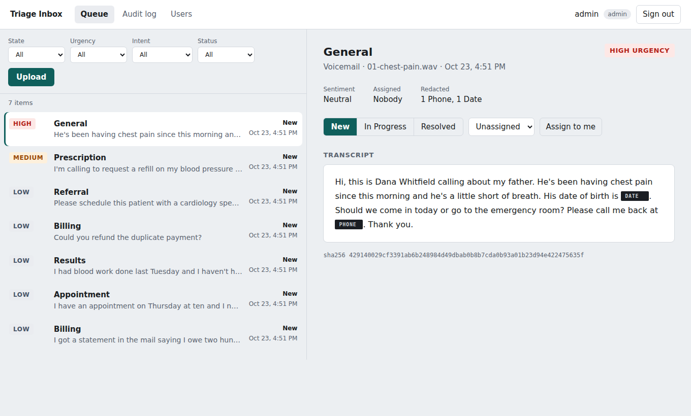
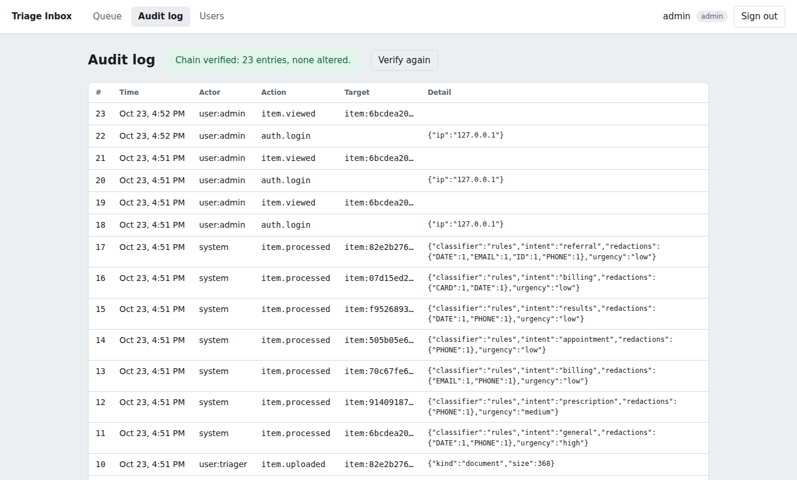
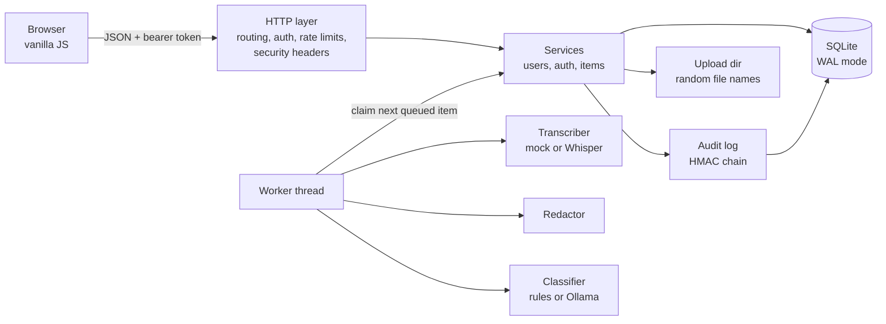

# Triage Inbox


A secure triage service for a clinic's incoming voicemails and documents. Each message is transcribed, scrubbed of personal identifiers, classified by intent and urgency, and placed in a shared queue with the urgent ones on top. Every login, upload, change, and read of message content goes into a tamper-evident audit log.

It runs on the Python standard library alone: no `pip install`, no external services, and no API keys. Real speech-to-text (Whisper) and a local LLM (Ollama) plug in when you want them.



> All data in this repository is synthetic. Names, phone numbers (555-01xx) and IDs are invented.

## What it does

- **Intake.** Upload `.wav`, `.mp3`, `.m4a`, `.txt` or `.md`. Files are checked by content, not just extension, and stored under random IDs.
- **Pipeline.** A background worker transcribes audio, redacts identifiers, classifies the result, and retries failures up to three times.
- **Redaction first.** Phone numbers, emails, SSNs, dates of birth, card numbers (Luhn-checked) and record IDs are replaced before anything is stored, displayed or sent to a model. The raw text is never written to the database, and the raw upload is deleted after processing.
- **Classification.** Intent (appointment, billing, prescription, results, referral, complaint, general), urgency and sentiment. The rule-based classifier works offline. The optional Ollama classifier is constrained to the same fixed labels and falls back to rules on any bad output.
- **Roles.** Viewers read, triagers upload and work the queue, admins manage users and the audit log.
- **Tamper-evident audit log.** Entries are HMAC-chained, so editing, reordering or deleting one is detected. `scripts/tamper_demo.py` shows it happen.



## Quick start

Requires Python 3.11 or newer. Nothing to install.

```bash
python -m triage seed-demo     # creates demo accounts (passwords printed once) and queues sample messages
python -m triage serve         # http://127.0.0.1:8000
```

Sign in as `triager` or `admin` with the printed password. The sample messages are processed within a few seconds.

Other commands:

```bash
python -m triage create-user maria --role triager   # prompts for a password
python -m triage verify-audit                       # exit code 2 if tampering is found
python scripts/tamper_demo.py                       # attack a copy of the DB, watch verification fail
python -m unittest discover -s tests -t .           # 60 tests
```

With Docker: `docker compose up --build`, then `docker compose exec app python -m triage seed-demo`.

## Architecture



| Module | Responsibility |
|---|---|
| `triage/server.py` | Routing, role checks, cookies, body limits, CSP and other headers, static files from an allowlist |
| `triage/services.py` | Users, login and token rotation, item intake, processing and triage |
| `triage/audit.py` | Append and verify the HMAC chain |
| `triage/redaction.py` | Ordered regex rules with Luhn validation for cards |
| `triage/providers/` | Transcribers and classifiers behind a small interface |
| `triage/security/` | scrypt passwords, strict HS256 tokens, token-bucket rate limiter |
| `triage/static/` | The single-page UI |

## Security design

The full analysis, including known gaps, is in [docs/THREAT_MODEL.md](docs/THREAT_MODEL.md). The decisions most worth discussing:

**Sessions.** A 15-minute access token lives only in the page's memory. The refresh token is an `HttpOnly`, `SameSite=Strict` cookie scoped to `/api/auth`, so page scripts can't read it, and it's stored server-side only as a SHA-256 hash. Each refresh token works once and is replaced by a new one. If a used token comes back, someone has a copy, so the whole session family is revoked and the event is audited.

**Authorization is checked against the database on every request.** The token says who you are, but your role and active status are re-read each time, so deactivating someone takes effect immediately rather than when their token expires.

**The audit log can't be quietly rewritten.** Each entry's HMAC covers its own fields plus the previous entry's HMAC. SQLite triggers block updates and deletes from the app, and the chain catches anyone who bypasses the triggers with direct file access. Without the secret key, an attacker can't recompute a valid chain. Audit entries are written in the same transaction as the action, so one can't exist without the other.

**Models only see redacted text, and their output is distrusted.** A message containing "ignore your instructions" can at worst select a wrong label from a fixed set, which the UI shows to a human anyway.

**Small, strict primitives.** The JWT verifier accepts exactly one header, which rules out `alg: none` and algorithm-confusion attacks. Passwords use scrypt. Separate keys for tokens and the audit log are derived from one secret. Failed logins take the same time whether or not the user exists.

## Configuration

| Variable | Default | Meaning |
|---|---|---|
| `TRIAGE_DATA_DIR` | `data` | Database, uploads and generated key |
| `TRIAGE_SECRET_KEY` | generated into `data/secret.key` | 32+ characters; set it explicitly in production |
| `TRIAGE_TRANSCRIBER` | `mock` | `mock` reads transcripts embedded in sample WAVs; `whisper` needs `pip install openai-whisper` and ffmpeg |
| `TRIAGE_CLASSIFIER` | `rules` | `ollama` uses a local model at `TRIAGE_OLLAMA_URL` (`TRIAGE_OLLAMA_MODEL`, default `llama3.1:8b`) |
| `TRIAGE_KEEP_UPLOADS` | `0` | Keep raw files after processing |
| `TRIAGE_SECURE_COOKIES` | `0` | Set to `1` behind HTTPS: adds `Secure` cookies and HSTS |
| `TRIAGE_ACCESS_TTL` / `TRIAGE_REFRESH_TTL` | `900` / `604800` | Token lifetimes in seconds |
| `TRIAGE_MAX_UPLOAD_BYTES` | `10485760` | Upload size limit |

## Testing

60 tests cover password hashing, token forgery and `alg: none`, rate limiting, every redaction rule, audit chain tampering (edits, deletions and forged hashes), refresh-token reuse detection, immediate deactivation, upload validation and path traversal, the full pipeline, role enforcement over HTTP, CSRF origin checks, and security headers. CI runs them on Linux and Windows across Python 3.11 to 3.13.

## Limitations

The mock transcriber only reads the sample WAVs; use Whisper for real audio. Redaction is pattern-based and misses names and spelled-out numbers. SQLite and per-process rate limits make this a single-node service. There is no TLS, MFA or encryption at rest built in. These and their fixes are listed in the threat model.

## Roadmap

- Export and compare the audit chain head to detect truncation
- Named-entity redaction for people's names
- TOTP multi-factor authentication
- Shared rate-limit store and Postgres for multi-node deployments
- Per-item retention policies with automatic purge

## License

MIT
